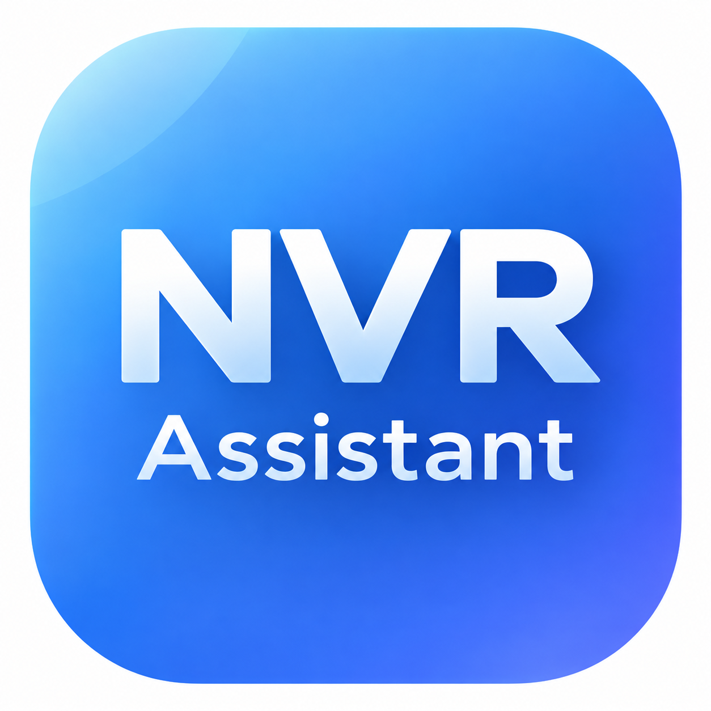

<div align="center">
  
  <h1>NVR Assistant</h1>
  <p>Windows 本地 NVR 巡检与摄像头反查工具</p>
</div>

## 项目简介

NVR Assistant 是一个面向海康威视 NVR 与摄像头的本地桌面工具。它通过
ISAPI 实时读取设备数据，支持批量巡检 NVR 通道，也可以从摄像头 IP 反向定位
所属 NVR、通道号和通道名称。

项目使用 Python 与 PySide6 开发，发布形式为 Windows 单文件便携 EXE。程序不
依赖服务器，不上传设备清单，也不内置任何 NVR 或摄像头凭据。

## 主要功能

- NVR 巡检支持 CSV 批量、单个 NVR 和多个 NVR 管理地址输入。
- 摄像头反查只以用户输入的摄像头 IP 或 CSV 为起点，实时查询 NVR，不读取
  `NVR_devices.py` 的历史报表、缓存或运行结果。
- NVR 名称优先从设备接口读取；状态接口失败与设备离线会分别展示。
- 支持并发查询、超时设置、任务取消、进度显示、运行日志和异常分类。
- 支持导出 CSV 与 XLSX；导出的结果不包含 NVR 登录密码。
- 设置页支持检查更新、直接下载 EXE、SHA256 校验和自动替换当前单文件 EXE。
- `v1.0.2` 起使用程序内置更新器，不再依赖独立的 `NVRUpdater.exe`。

## 便携版使用

1. 下载 Release 中的 `NVR Assistant.exe`。
2. 将 `NVR Assistant.exe` 放到任意可写目录。
3. 运行 `NVR Assistant.exe`。
4. `NVR Assistant.exe` 可以单独复制到桌面使用，不需要保留所在文件夹，
   也不需要 `_internal` 目录。

从 `v1.0.2` 或更早版本升级时，需要手动下载一次 `v1.0.4` 的
`NVR Assistant.exe` 并替换旧程序。旧版更新器只接受 ZIP，无法直接安装 EXE。
完成这次手动替换后，后续版本可由程序内置更新器直接下载并替换 EXE。

首次使用建议：

1. 在“NVR 巡检”页选择或输入 NVR 管理地址。
2. 在“摄像头反查”页输入摄像头 IP，并选择 NVR 清单 CSV。
3. 查询结果可点击统计卡片筛选，并导出 CSV 或 XLSX。

## 数据文件格式

### NVR 清单 CSV

摄像头反查必须提供 NVR 清单。最少需要以下三列：

```csv
ip,username,password
192.168.1.10,admin,example-password
192.168.1.11,admin,example-password
```

`ip` 是 NVR 管理地址，`username` 和 `password` 用于登录 NVR ISAPI。密码只在
本次运行中使用，不写入设置和导出结果。

### 摄像头 CSV

摄像头 CSV 只要求摄像头 IP 列，推荐使用 `camera_ip`：

```csv
camera_ip
10.0.0.10
10.0.0.11
10.0.0.12
```

如果原来的摄像头 CSV 中存在摄像头密码列，程序会忽略该列，也不会记录密码。

## 开发运行

```powershell
py -m venv .venv
.\.venv\Scripts\Activate.ps1
pip install -r requirements-gui.txt
python nvr_assistant.py
```

运行测试：

```powershell
$env:QT_QPA_PLATFORM = "offscreen"
python -m unittest discover -s tests -v
```

## 构建 Windows 便携包

```powershell
pip install -r requirements-build.txt
.\build_nvr_assistant.ps1
```

构建结果：

```text
dist\NVR Assistant.exe
dist\NVR Assistant.exe.sha256
```

程序采用 PyInstaller 单文件结构。安装更新时，内置更新器会等待主程序退出，
然后直接用下载并校验过的 `NVR Assistant.exe` 替换当前单文件 EXE，不会修改
同目录中的其他文件，因此不需要 `NVRUpdater.exe`。

## 更新与发布流程

主程序从 GitHub Raw 读取根目录 `version.json`，在清单不存在时回退到 GitHub
Releases API。发布新版本时按以下顺序操作：

1. 修改 `nvr_app/__init__.py` 中的 `__version__`。
2. 同步修改 `version_info.txt`、`nvr_updater_version_info.txt` 和 `version.json`。
3. 运行 `build_nvr_assistant.ps1` 生成 EXE。
4. 将 EXE 的 SHA256 写入 `version.json`。
5. 提交并推送 `main`。
6. 创建对应版本标签和 GitHub Release。
7. 上传 `NVR Assistant.exe`，文件名必须与 `version.json` 中的
   `download_url` 完全一致。

`version.json` 示例：

```json
{
  "version": "1.0.4",
  "download_url": "https://github.com/paynehe3023/NVR-Assistant/releases/download/v1.0.4/NVR%20Assistant.exe",
  "notes": "v1.0.4：自动更新改为直接下载 NVR Assistant.exe。",
  "published_at": "2026-10-15",
  "sha256": "填写 EXE 的 SHA256"
}
```

更新程序包含在 `NVR Assistant.exe` 内。下载完成后，主程序会启动一个临时
自更新副本，等待原程序退出后替换当前单文件 EXE 并自动重启。

当前 `version.json` 中的 `sha256` 如果为空，程序仍会检查 EXE 文件头，但不会
进行固定哈希校验。正式发布建议始终填写 SHA256。

## 安全说明

- 仓库不得提交 `.env`、真实 NVR CSV、真实摄像头 CSV、导出结果、日志或证书。
- 仓库只保留 `NVRdevices.example.csv` 和 `cameras.example.csv` 等无敏感值模板。
- 曾在 Git 历史中出现过的密码应立即轮换，删除文件本身不能消除泄露风险。
- 摄像头反查不需要摄像头密码；NVR 登录密码只由用户在本地运行时提供。

## 作者

payne

## 许可证

当前仓库未附加单独的许可证文件。如需对外授予复制、修改或分发权限，应补充
明确的 LICENSE 文件。
